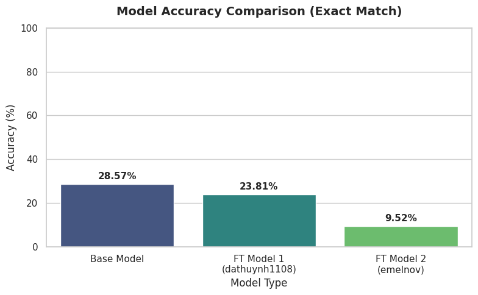

# 🚀 Web Auto-Login Framework with Offline AI CAPTCHA Solver

[](https://www.python.org/)
[](https://www.selenium.dev/)
[](https://pytorch.org/)
[](https://huggingface.co/anuashok/ocr-captcha-v3)
[](LICENSE)

An intelligent, modular browser automation framework built with **Python**, **Selenium**, and **TrOCR (Vision-Encoder-Decoder)**.

It provides an interactive popup for entering credentials on any website, dynamically discovers form elements using **DOM heuristics**, solves image CAPTCHAs **100% offline**, and maintains persistent browser sessions.

---

## ✨ Features

- **🖥️ Interactive Credential Popup**: Native GUI dialog built with `Tkinter` to input or modify target URLs, usernames, and passwords (with masked input and show/hide toggle).
- **🌐 Generic Link Support**: Smart heuristic engine that automatically detects login fields (username, password, captcha image, captcha input, and submit buttons) on any generic website without hardcoded selectors.
- **🧠 100% Offline AI CAPTCHA Solver**: Utilizes [anuashok/ocr-captcha-v3](https://huggingface.co/anuashok/ocr-captcha-v3) TrOCR model stored locally on disk. Fast, zero API costs, and immune to Hugging Face Hub rate limits.
- **🎯 Site Profile Support**: Register precise selectors for specific high-priority websites (e.g. SSLCommerz Merchant Portal) with automatic fallback to generic heuristics.
- **🔒 Session & 2FA Persistence**: Keeps the Chrome browser open with `detach: True`, allowing seamless transition to manual OTP/SMS two-factor verification or dashboard inspection.

---

## 📁 Project Structure

```text
├── models/
│   └── ocr-captcha-v3/        # Offline TrOCR model weights & configurations
├── rnd/
│   └── model_benchmark.png    # Accuracy comparison chart across evaluated models
├── images/
│   └── temp_captcha.png       # Scratch storage for captured CAPTCHAs
├── Captcha_breaker_RnD.ipynb  # Interactive R&D notebook evaluating multiple OCR models
├── popup.py                   # Tkinter GUI credential & URL popup
├── framework.py               # Generic automation engine & DOM heuristics
├── captcha_solver.py          # Offline TrOCR inference module
├── download_model.py          # Utility script to pre-cache the OCR model
├── run_automation.py          # Main execution entrypoint
├── requirements.txt           # Project dependencies
├── .env.example               # Example environment file
└── README.md
```

---

## 🔬 HF Model Benchmarks (R&D)

To select the most robust OCR engine for diverse real-world CAPTCHAs, an extensive empirical benchmark was conducted across multiple Vision-Encoder-Decoder models on 21 challenging CAPTCHA variants (covering warped fonts, strike lines, speckle noise, drop shadows, low contrast, and alternating cases).

The full experimental workflow, predictions, and evaluation code are documented in:  
📄 **[`Captcha_breaker_RnD.ipynb`](Captcha_breaker_RnD.ipynb)**

### 📊 Benchmark Comparison (Exact Match Accuracy)

<p align="center">
  
</p>

| Model                     | Hugging Face Repository                                                                                 | Exact Match Accuracy | Evaluation Insights                                                                                                                                                             |
| :------------------------ | :------------------------------------------------------------------------------------------------------ | :------------------: | :------------------------------------------------------------------------------------------------------------------------------------------------------------------------------ |
| **Base Model (Selected)** | [`anuashok/ocr-captcha-v3`](https://huggingface.co/anuashok/ocr-captcha-v3)                             |      **28.57%**      | **Highest overall accuracy.** Exhibits superior generalization across varied font weights, noise speckles, and distorted characters. Selected as the framework's default model. |
| **FT Model 1**            | [`dathuynh1108/ocr-captcha-v3-finetuned`](https://huggingface.co/dathuynh1108/ocr-captcha-v3-finetuned) |        23.81%        | Competitive on standard alphanumeric strings but suffered degradation on heavy background noise and stroke artifacts.                                                           |
| **FT Model 2**            | [`emelnov/ocr-captcha-v4-mailru`](https://huggingface.co/emelnov/ocr-captcha-v4-mailru)                 |        9.52%         | Specialized primarily for Mail.ru CAPTCHA formats; struggled with mixed casing and complex multi-word distortions.                                                              |

---

## 🚀 Quick Start

### 1. Clone the Repository

```bash
git clone https://github.com/your-username/local_automation.git
cd local_automation
```

### 2. Set Up Virtual Environment & Dependencies

```bash
# Create virtual environment
python -m venv venv

# Activate virtual environment
# On Windows:
venv\Scripts\activate
# On macOS/Linux:
source venv/bin/activate

# Install requirements
pip install -r requirements.txt
```

### 3. (Optional) Configure Default Credentials

Copy the example environment file to `.env`:

```bash
cp .env.example .env
```

Edit `.env` to pre-fill your credentials in the popup:

```env
MERCHANT_ID=your_username_or_id
MERCHANT_PASSWORD=your_secure_password
```

### 4. Cache Model Locally

Download and store the model weights in `./models/ocr-captcha-v3/` for offline use:

```bash
python download_model.py
```

_(If you skip this step, the framework will automatically download and save the model on your first run)._

### 5. Run the Automation

```bash
python run_automation.py
```

A popup dialog will appear:

1. Enter or paste your **Target URL**.
2. Type or confirm your **Username / ID** and **Password**.
3. Click **Start Auto-Login →**.

The framework will launch Chrome, navigate to the page, fill your credentials, solve the CAPTCHA, submit the form, and leave the browser open.

---

## 🛠️ How Generic Link Heuristics Work

When an unfamiliar URL is passed to the framework, the heuristic engine resolves elements dynamically:

| Element           | Heuristic Strategy                                                                                                                              |
| :---------------- | :---------------------------------------------------------------------------------------------------------------------------------------------- |
| **Password**      | Detects the primary visible `input[type='password']` element.                                                                                   |
| **Username**      | Evaluates preceding visible inputs relative to the password field, followed by common attributes (`name="user"`, `id="login"`, `type="email"`). |
| **CAPTCHA Image** | Scans for image/canvas tags matching `captcha`, `capture`, or `setCapture` keywords with valid display dimensions.                              |
| **CAPTCHA Input** | Identifies text inputs associated with captcha keywords or adjacent to the captcha image.                                                       |
| **Submit Button** | Searches for submit buttons inside the form, button text matching `Login` / `Sign In` / `Submit`, or sends the `ENTER` key.                     |

---

## ⚙️ Adding Custom Site Profiles

To register explicit selectors for a specific website, add a new `SiteProfile` in [framework.py](file:///d:/Personal-projects/local_automation/framework.py):

```python
from framework import SiteProfile, By

my_site = SiteProfile(
    name="My Custom Portal",
    url_identifier="myportal.com",
    user_selector=(By.ID, "username"),
    pass_selector=(By.ID, "password"),
    captcha_img_selector=(By.ID, "captcha-img"),
    captcha_input_selector=(By.ID, "captcha-code"),
    submit_selector=(By.CSS_SELECTOR, "button.btn-login")
)

framework.register_profile(my_site)
```

---

## ⚖️ Disclaimer & Ethical Use Notice

> [!WARNING]
> **Strictly for Educational, Learning, and Legitimate Personal Automation Purposes Only.**
>
> - The CAPTCHA recognition functionality is provided strictly as a technical demonstration of OCR and deep learning models (TrOCR) integrated with browser automation workflows.
> - **Do NOT use this tool for unethical, unauthorized, or malicious actions**, including but not limited to credential stuffing, unauthorized data harvesting, bypassing security safeguards on third-party services without permission, or violating any website's Terms of Service (ToS).
> - The author is not responsible for any misuse, account suspensions, or legal liabilities arising from the use or modification of this project. Always ensure you have authorization before automating interactions with any web application.

---

## 🛡️ License

This project is licensed under the MIT License - see the [LICENSE](LICENSE) file for details.
